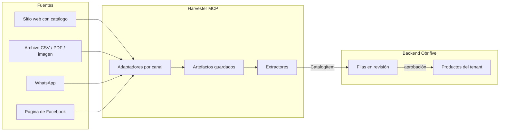

<Callout title="En resumen">
  `harvester/` es un servidor MCP (FastMCP) que convierte fuentes externas en productos candidatos para revisión; no escribe en la base de datos. Los experimentos dejaron tres conclusiones: los sitios web con catálogo se pueden extraer ya, incluido el precio cuando lo publican; las cotizaciones por WhatsApp quedan por resolver; y Facebook solo aporta la ficha de la página (sitio web, contacto) y pocas publicaciones.
</Callout>

Esta página mezcla lo que existe hoy con lo que falta. Cada parte del plan sale de aquí cuando se implementa. Las rutas son relativas a `harvester/`.

## Lugar en la arquitectura

- **El harvester solo extrae.** Devuelve `CatalogItem` con nombre, SKU, precio en BOB, unidad, identidad externa (`external_id`, `external_url`), procedencia y confianza.
- **El backend decide.** Concilia por identidad externa y luego por SKU, guarda las filas en revisión y aplica los cambios, como define [el catálogo por tenant](../guias/backend/catalogo-productos.mdx).
- **El tenant no entra al harvester.** Lo resuelve el backend antes de guardar.

## Qué existe hoy

| Pieza | Ubicación | Estado |
| --- | --- | --- |
| Contratos y puertos | `src/domain/` | `Source`, `Target`, `Artifact`, `CatalogItem`, `SourceAdapter`, `ItemExtractor`, `ArtifactStore` |
| Normalización de precios | `src/domain/normalization.py` | `parse_bob_price` acepta `Bs. 1.250,50`, `12,5`, `BOB 45` |
| Casos de uso | `src/application/use_cases.py` | Detectar, listar, descargar, extraer y `HarvestSource` para todo el flujo |
| Adaptador de archivos | `src/infrastructure/adapters/file_source_adapter.py` | URLs `http(s)` a archivos e `inbox://ruta`, con tope de tamaño y sin salir de la carpeta inbox |
| Extractor CSV | `src/infrastructure/extractors/csv_item_extractor.py` | Encabezados en español, separador `,` o `;` |
| Servidor MCP | `src/presentation/server.py` | Herramientas `detect_source`, `list_targets`, `fetch_target`, `extract_items`, `harvest` |

Comandos: `just harvester install`, `just harvester dev` (stdio), `just harvester serve` (HTTP en :8300), `just harvester test` y `just harvester check`. El detalle de capas y configuración está en el [README del harvester](../../../../harvester/README.md).

## Conclusiones de los experimentos

Los experimentos se hicieron el 2026-10-26 sobre ferreterías bolivianas, con volumen bajo y sin sesión. Los resultados completos están en [`harvester/experiments/`](../../../../harvester/experiments/README.md).

| Canal | Experimento | Qué se encontró | Decisión |
| --- | --- | --- | --- |
| Sitios web con catálogo | [E1](../../../../harvester/experiments/e1_resultados.md) | 8 sitios, 6 con catálogo. Galba (837 productos, 91 % con precio) y Morales (607 productos) publican precios en BOB; Pari y las tiendas de Construex no | **Avanzar** con la extracción, incluido el precio cuando existe |
| Cotización por WhatsApp | [E3](../../../../harvester/experiments/e3_resultados.md) | Los 4 sitios con número tienen cuenta WhatsApp Business con catálogo, pero no se puede leer desde un navegador | **Pendiente** de resolver |
| Facebook | [E2](../../../../harvester/experiments/e2_resultados.md) | Sin sesión solo se ve la ficha (sitio web, teléfono, correo) y 1 o 2 publicaciones; después aparece el login | **Solo descubrimiento** de otros canales |

### 1. Sitios web con catálogo: implementar

WooCommerce es la plataforma más común y su Store API pública entrega el catálogo completo con SKU, categoría y precio. Ningún sitio expone datos estructurados `schema.org/Product`, así que un extractor genérico de JSON-LD no aporta.

| Adaptador | Cubre | Cómo lee | Prioridad |
| --- | --- | --- | --- |
| WooCommerce Store API | Galba, Pari | `wp-json/wc/store/v1/products`, paginado | 1 |
| Construex | Ferretería Capriles, Todo Ideal, El Ofertón y cualquier otra tienda del marketplace | HTML del servidor, listado por tienda | 2 |
| Shopify con navegador | Morales | Playwright; las llamadas HTTP directas responden 429 | 3 |

Reglas para estos adaptadores:

- Un producto sin precio entra a revisión con `price_bob` vacío; el precio se completa después por otro canal.
- `external_id` y `external_url` salen de la fuente (ID de WooCommerce, URL del producto) para que la conciliación no duplique productos.
- Respetar `robots.txt` y las señales de contenido del sitio, con pocas solicitudes por segundo.

### 2. Cotización por WhatsApp: pendiente

Es el canal donde vive la mayoría de los precios: casi todas las webs dicen "cotiza por WhatsApp", y el catálogo de WhatsApp no se lee desde fuera. Queda descartado escribir automáticamente a ferreterías que no aceptaron recibir mensajes, usar clientes no oficiales de WhatsApp o un bot que se haga pasar por cliente.

Vías por evaluar, de menor a mayor esfuerzo:

<Steps>
  <Step>
    ### Pedido manual de cotizaciones

    Pedir por WhatsApp, con identidad real, la misma canasta de unos 10 productos a 5–10 ferreterías. Mide en qué formato responden (texto, PDF, foto, nota de voz) y deja material para evaluar modelos de visión.
  </Step>
  <Step>
    ### Flujo automatizado en un entorno de prueba

    Número de prueba de WhatsApp Cloud API, webhook hacia el harvester y teléfonos propios haciendo de ferretería. Valida recibir y descargar el archivo, extraerlo y pedir aclaraciones dentro de la ventana de 24 horas.
  </Step>
  <Step>
    ### Piloto con ferreterías que aceptan

    Una o dos ferreterías aliadas guardan el número de Obrifive y reenvían sus listas y cotizaciones. Es el uso real del canal.
  </Step>
</Steps>

Antes de construir el extractor de imágenes hay que elegir modelo (E4): precisión por campo y costo por imagen sobre material real.

### 3. Facebook: solo descubrimiento

La ficha pública de una página sirve para encontrar el sitio web, el número de WhatsApp y el correo de la ferretería; de ahí se deriva al adaptador de cada canal. Así se encontró Galba, la web más completa de la muestra. Leer publicaciones y fotos solo es viable con autorización de la ferretería mediante Graph API; el scraping sin sesión queda descartado.

## Plan de tareas

| Tarea | Canal | Depende de | Estado |
| --- | --- | --- | --- |
| Adaptador WooCommerce Store API | Web | — | Lista para empezar |
| Adaptador Construex | Web | — | Lista para empezar |
| Normalización de unidades y presentaciones (bls, pza, m, kg, 1 L / 4 L) | Todos | — | Lista para empezar |
| Set de evaluación con fixtures por canal | Todos | — | Lista para empezar |
| Adaptador Shopify con navegador | Web | Playwright en el harvester | Después de WooCommerce |
| Detección de `wa.me` y fichas de Facebook que derivan a otros canales | WhatsApp, Facebook | — | Lista para empezar |
| Extractor de PDF digital (texto y tablas) | Archivos | PDFs reales de ferreterías | Esperando material |
| Elección de modelo de visión (E4) y extractor de imágenes | Archivos, WhatsApp | Clave de API e imágenes reales | Esperando material |
| Webhook de WhatsApp Cloud API | WhatsApp | Decisión sobre el canal | Pendiente |
| Graph API de Facebook con autorización de la página | Facebook | Interés de las ferreterías (E5) | Condicional |
| Puente worker → harvester → filas en revisión | Backend | Tablas de revisión del catálogo | Pendiente |

Tener el harvester como servicio aparte es una decisión de límites entre módulos; falta registrarla en un [ADR](../equipo/adr/index.md).
