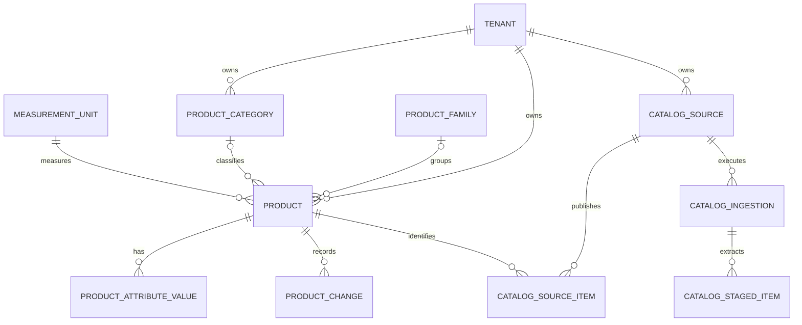
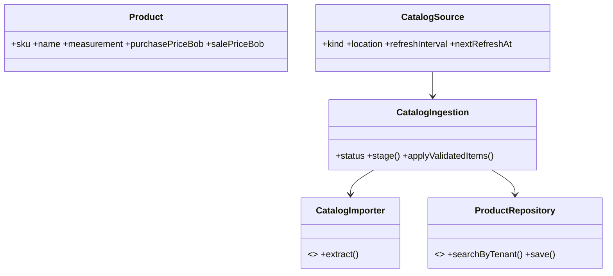

# Plan de implementación: productos por tenant

## Objetivo

Incorporar un catálogo aislado por tenant para productos de ferretería y
construcción. Cada presentación vendible es un producto (SKU); una familia puede
agrupar presentaciones como pintura de 1 L, 4 L y 20 L.

## Decisiones acordadas

- Los precios se guardan como `Decimal` en BOB; la interfaz acepta coma o punto
  y los normaliza antes de enviarlos.
- El stock es una observación decimal opcional, no un kardex ni reserva.
- Las cargas válidas se aplican automáticamente. Las ambiguas o inválidas quedan
  para revisión sin alterar el catálogo.
- La reconciliación usa primero la identidad externa/URL de la fuente y luego el
  SKU único del tenant.
- Excel es el primer adaptador operativo; PDF se extrae a staging para revisión;
  el scraping web usa un puerto extensible y conectores por tienda.
- La ausencia en una fuente no elimina ni desactiva productos: registra la última
  observación para revisión.

## Modelo

## Entregas

1. Esquema, modelos de dominio, repositorios, casos de uso y API de catálogo.
2. Búsqueda, filtros, CRUD y UI protegida por tenant.
3. Fuentes, importador Excel, staging PDF, auditoría y cola de actualización.
4. Conectores de scraping por sitio sin alterar el modelo central.
5. Skill `product-catalog-ddd` canónico en `.claude/skills`, sincronizado a
   `.agents/skills` para Claude y Codex.
